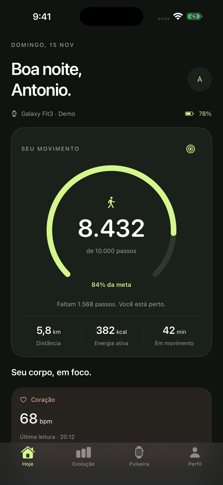

# Primeira execução nativa do FitΛ

**Resultado: compilação, instalação, abertura e captura no simulador concluídas com sucesso.** O processamento ocorreu em um Mac do GitHub Actions; não foi necessário um Mac local.

## Evidência

| Item | Registro |
| --- | --- |
| Código compilado | [`49db6b8345bcf55431f334df08c4251231016b59`](https://github.com/Antoniorjr4/Fit/commit/49db6b8345bcf55431f334df08c4251231016b59) |
| Workflow | [FitLambda - native UI validation, run 1](https://github.com/Antoniorjr4/Fit/actions/runs/43778584651) |
| Job | `build-ui`, ID `133010411717`, conclusão `success` |
| Início / conclusão do run | 16/11/2026, 00:08:23–00:13:00 UTC |
| Runner | `macos-15` |
| Xcode | 16.4, build 16F6 |
| XcodeGen | 2.46.0 |
| Simulador selecionado | iPhone 16 Pro Max, runtime iOS 26.2 |
| Captura original | PNG, 1320 × 2868 pixels |
| Abertura | `com.annalabs.fitlambda: 5028` |

O log termina em `BUILD SUCCEEDED`. A etapa seguinte instalou e abriu o app, produziu a imagem abaixo e publicou o artefato. A captura foi inspecionada: a tela Hoje está renderizada, com a meta de passos, os indicadores e a barra das quatro abas visíveis. Não foram observados problemas evidentes de sobreposição ou textos truncados na região visível. O conteúdo continua abaixo da área inicial de rolagem.



Todos os valores de saúde, atividade, bateria e conexão mostrados são de demonstração.

## O que esta execução comprova

- O projeto XcodeGen gera um app que compila com o Xcode indicado.
- O binário de simulador instala e abre no dispositivo virtual selecionado.
- A primeira tela nativa renderiza com a identidade visual do FitΛ.
- A rotina funciona na nuvem e publica evidências para revisão no Windows ou Linux.

## Limites

A revisão visual abrange a tela Hoje no estado inicial, em modo escuro e no simulador indicado. Não foram exercitadas todas as abas, folhas, tamanhos de texto, tamanhos de tela ou o modo claro nesta execução. A implantação mínima configurada é iOS 17, mas esta execução não valida o comportamento no runtime iOS 17.

O artefato é um app para simulador. Esta etapa não gera uma IPA para iPhone físico nem uma versão TestFlight. Não valida Bluetooth, pareamento com a Fit3, HealthKit, notificações ou transmissão de mostradores.

## Integridade e retenção

O artefato `FitLambda-native-ui-1` (ID `14187527490`) foi baixado e seu SHA-256 conferido:

```text
dfe1e4cbd2c39a555ab3f9a576cfe6cd6c9599b0848c900b481a54a792813101
```

O download completo permanece no run até a expiração informada pelo GitHub, em 23/11/2026 às 00:12:39 UTC. A captura original e este registro ficam preservados no repositório. A confirmação refere-se ao commit de código acima; a publicação deste registro altera apenas documentação e imagem.
