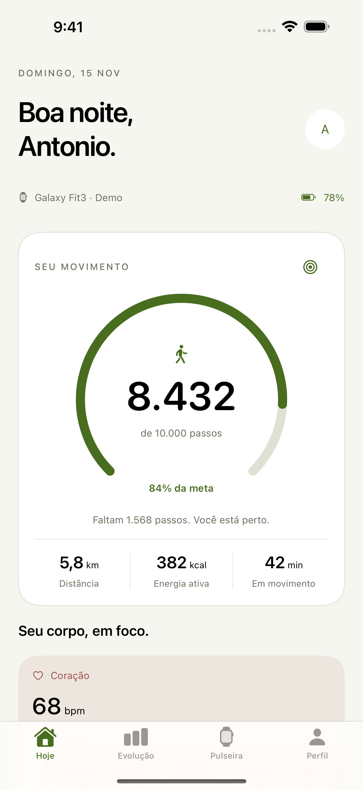
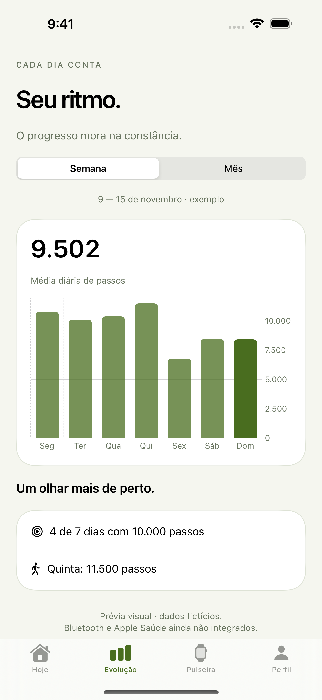
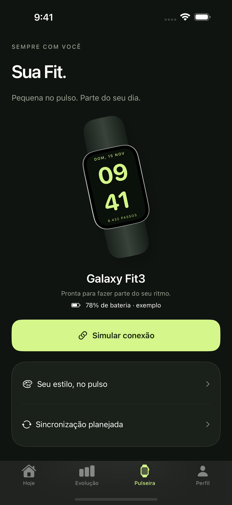
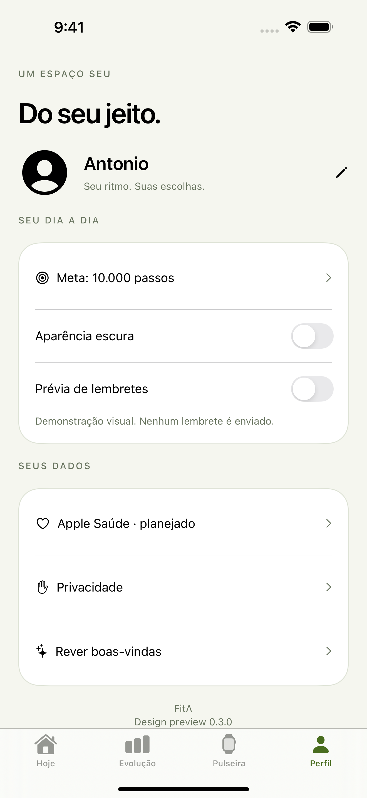
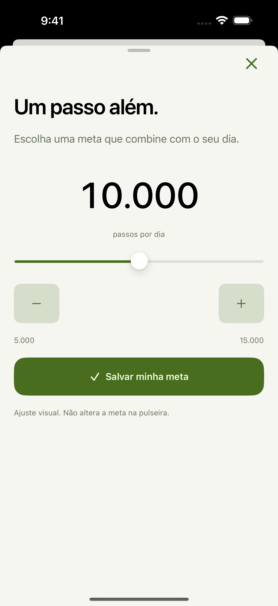
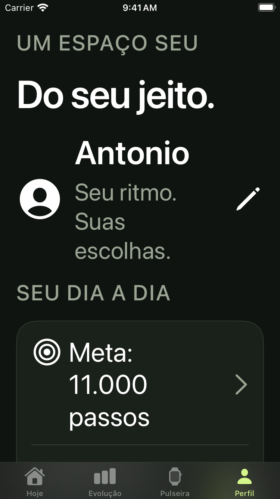

# FitΛ 0.3.0 — interface nativa validada

**Nove execuções de testes aprovadas, nenhuma falha e nenhum teste ignorado.** O aplicativo foi compilado, instalado e aberto em simuladores do Xcode no GitHub Actions. Esta versão continua usando dados de demonstração.

## Execução

| Registro | Valor |
| --- | --- |
| Workflow | [Run 6 — sucesso](https://github.com/Antoniorjr4/Fit/actions/runs/43851101290) |
| Código testado | [`16ca247fa33e4600dd55be224dddc779df7ee7c3`](https://github.com/Antoniorjr4/Fit/commit/16ca247fa33e4600dd55be224dddc779df7ee7c3) |
| Job | `133244110253` · `build-ui` |
| Execução do job | 16/11/2026, 10:41:27–10:56:17 UTC |
| Xcode | 16.4, build 16F6 |
| XcodeGen | 2.46.0 |
| SDK e runtime | iOS 18.5 |
| iPhone 16 Pro Max | 7 aprovados · 0 falhas · 0 ignorados |
| iPhone SE (3ª geração) | 2 aprovados · 0 falhas · 0 ignorados |

São sete métodos de teste, com os de meta e texto ampliado repetidos no SE. Os [resumos do dispositivo principal](main-summary.json) e [do dispositivo compacto](compact-summary.json) foram copiados sem alteração do artefato. As versões utilizadas estão em [environment.txt](environment.txt).

## Capturas originais

As imagens abaixo são capturas do app SwiftUI em execução. Não são montagens nem telas geradas a partir do protótipo web. Clique para ampliar.

| Hoje · modo claro | Evolução · modo claro |
| --- | --- |
|  |  |

| Pulseira · modo escuro | Perfil · modo claro |
| --- | --- |
|  |  |

| Edição da meta · modo claro | Perfil · texto ampliado no SE |
| --- | --- |
|  |  |

As capturas mostram o enquadramento de cada momento, não a página inteira. O conteúdo que ultrapassa a tela fica em uma área rolável. Na imagem do SE, a meta de 11.000 passos é o resultado da edição feita pelo teste.

## O que foi verificado

- Navegação pelas quatro abas e alternância Semana/Mês.
- Salvar e cancelar alterações de meta, nome e mostrador conceitual; nome vazio bloqueia o salvamento.
- Concluir as três etapas da conexão de demonstração.
- Abrir e fechar detalhes, privacidade e boas-vindas.
- Trocar entre modo claro e escuro, com capturas das quatro abas.
- Navegar, editar meta e concluir a simulação com Dynamic Type Accessibility 3, incluindo o iPhone SE.

Os cenários e as asserções estão descritos em [UI_JOURNEYS.md](../../UI_JOURNEYS.md). A inspeção visual das capturas selecionadas confirmou a formatação brasileira no gráfico, o verde nos controles da folha de meta, a consistência do texto secundário no modo claro e as quebras de linha no layout compacto com texto ampliado. Os testes verificam comportamento; as imagens documentam o aspecto visual.

## Proveniência e limites

Artefato: `FitLambda-native-ui-6`, ID `14217834171`, 17.027.765 bytes. SHA-256 do ZIP baixado e verificado: `e4288451f3ddf071c4956dd33631c9324b22b1c57b57de7d2d4e065f56dbf96b`. A retenção do artefato completo termina em 23/11/2026, às 10:56:06 UTC. As imagens e os resumos desta pasta ficam preservados no repositório; os resultados `.xcresult`, logs completos e demais capturas permanecem no artefato durante a retenção. O [manifesto](evidence.json) associa cada imagem ao arquivo original e ao seu hash.

Esta validação cobre os modelos e o runtime acima, com o tamanho padrão e Accessibility 3 nos fluxos descritos. Não certifica todas as configurações de acessibilidade, VoiceOver, iOS 17 ou aparelhos físicos. Preferências ainda ficam em memória. Bluetooth, HealthKit, notificações e comandos da Fit3 não estão integrados. O pacote compilado é para simulador; ainda não há IPA assinada ou distribuição pelo TestFlight.
